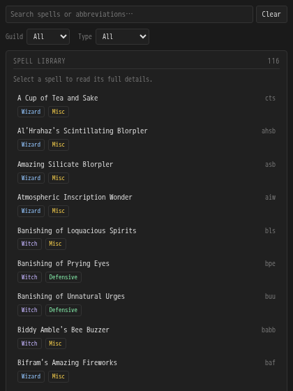
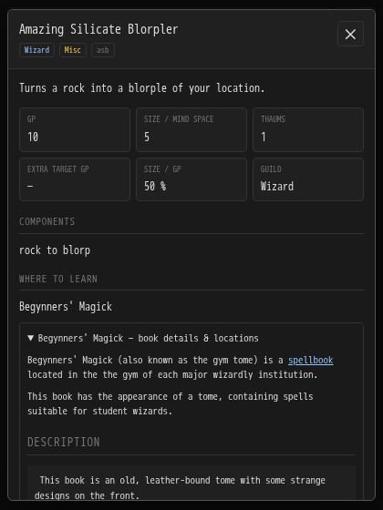

# Being's Discworld Spell Library

An offline reference for 116 current Discworld spells, styled like Being's Discworld Blorp Recorder. Requires Mallard 0.27.0 or later.

## Using the library

Open the Spell Library panel. Spells are sorted A–Z, with their abbreviation, **Wizard** / **Witch** badges, and **Misc**, **Offensive**, or **Defensive** type. Shared spells show both guilds. Search by name or abbreviation; filter by guild and type.

Select a spell to open its detail popup. It contains GP, size/mind space, thaums, components, casting skills, skill-bonus chart estimates, learning sources, book locations, and the full wiki article: acquisition, effects, syntax, casting messages, research tables, notes, and other documented information. Expand a spell book to read its locations and details. Close with × or Escape.

The library contains all current entries in the supplied wiki's wizard and witch spell tables. Retired/lost spells are excluded. Data reflects that backup, not live game updates. Missing information is identified rather than invented. Green-chart bonus suggestions are approximate readings of the wiki charts and do not guarantee success; learning levels and written recommendations remain in the spell article.

The plugin is read-only. It requests no sending, GMCP, database, network, or notification permissions. The list and popup work entirely offline. Wiki links are optional references.

## Sources

Data is extracted and reformatted from the Discworld MUD Wiki backup supplied by the user. Each spell includes its source, revision, and last-modified information. Spell-book articles are bundled for location references. See [NOTICE](NOTICE) for attribution. Spell data remains attributed to its wiki contributors; the MIT license covers the plugin code.

## Development

```sh
python3 -m unittest discover -s tests -v
python3 tests/panel_test.py
python3 scripts/build.py
```

Runtime tests require Lua 5.4's shared library. Browser tests require Playwright 1.63.0 and Chromium. The package is reproducible and includes the prebuilt library; building does not require the wiki backup or Python dependencies.

To refresh the bundled data:

```sh
python3 -m pip install -r scripts/requirements-import.txt
python3 scripts/import_wiki.py /path/to/backup/dwwiki.mooo.com/wiki
```

The importer only reads the backup, removes active wiki markup, and preserves article text, tables, spellcheck charts, and source references. No wiki scripts or network assets are shipped.

## Preview




